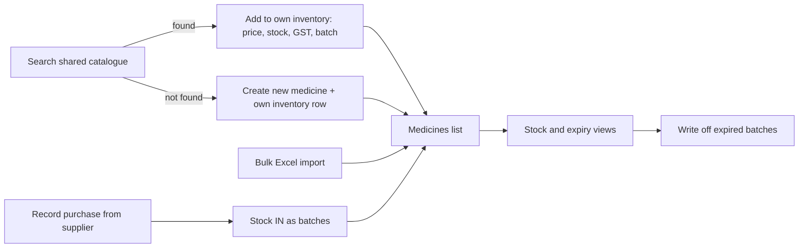
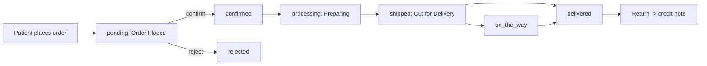
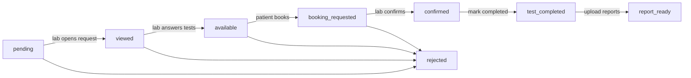

# Application Overview

## Purpose

`frontend-mr` is the **provider-side web console** of the Indian Health System. It is used by organisations that fulfil patient requests that originate in the patient website and patient mobile app:

* **Pharmacies** (`medicine_store`, `pharmacy_hospital`) sell medicines listed in a shared global catalogue, receive patient orders and prescription uploads, and manage stock, purchases, billing and reports.
* **Diagnostic Lab Centers** (`diagnostic_lab`) receive prescriptions shared by patients, say which tests they can perform, confirm bookings and upload reports.

It is one of several IHS web portals (patient, doctor, admin, clinic, MR/medicine, ambulance, blood bank). Other portals are linked only through environment URLs (`NEXT_PUBLIC_PATIENT_URL`, etc.); this app does not link to them in the UI that was read.

## Users and roles

| Role value | Label in UI (`roleLabel`) | Registerable here | Dashboard |
|---|---|---|---|
| `medicine_store` | Pharmacy Medicine Store / Clinic | Yes | `PharmacyOverview` |
| `pharmacy_hospital` | Pharmacy Hospital | Yes | `PharmacyOverview` |
| `diagnostic_lab` | Diagnostic Lab Center | Yes | `LabOverview` |
| `mr` | Medicine Representative | No (retired; existing accounts only) | `PharmacyOverview` |
| `patient`, `doctor`, `admin`, `clinic` | (labels exist) | No | not intended for this portal |

Source: `src/types/index.ts`, `src/features/dashboard/nav.ts`, `src/app/(auth)/register/page.tsx`.

## Pharmacy workflows

### Inventory and purchasing

1. **Add Medicine** (`/medicines/new`): the provider first searches the global catalogue (`GET /medicine/masters`). Picking a match creates only the provider's own inventory row (price, stock, commercial fields); choosing "Add new" also collects the medicine's details. Optional batch number and expiry can be entered with opening stock. Images and substitutes are attached to the *global* medicine afterwards.
2. **Bulk Import** (`/medicines/import`): download template, upload, validate and preview (nothing is written), then import; duplicate strategy is `skip` or `update`.
3. **Purchases**: record a supplier bill (`/purchases/new`); the backend adds stock by batch. A purchase can be cancelled from its detail page.
4. **Stock and expiry** (`/inventory`): tabs for expiring soon, expired, all batches, low stock, out of stock; a "Write off expired stock" action.

### Patient order fulfilment

The allowed next steps shown to the user are defined in `src/features/pharmacy/status.ts` (`ORDER_NEXT_STATUS`) and mirror the backend transition table, which re-validates every change. For orders paid by **UPI QR**, the pharmacy sees a "Mark payment received" action (`POST /medicine/orders/groups/:id/payment/confirm-received`) because the patient app cannot know money arrived. A tax invoice is derived from the order and can be printed with the browser (`window.print()`); returns create credit notes.

### Prescription requests

Patients upload and share prescriptions. The provider opens `/prescriptions/:id`, views the file through an authenticated blob download (no public URL), ticks which medicines from its own inventory are available (quantity per item) or adds free-text "not available" rows, and submits (`PUT /medicine/prescriptions/:id/availability`) or rejects (`PUT .../status`). The patient then orders from the available items in the patient app. Orders created from a prescription link back to it (`/orders/:id` shows "From prescription").

## Diagnostic lab workflow

Statuses (`src/features/diagnostics/status.ts`): `pending`, `viewed`, `available`, `booking_requested`, `confirmed`, `test_completed`, `report_ready`, `rejected`.

The "viewed" transition is triggered automatically when the lab opens a pending request (`diagnostics/[id]/page.tsx` calls `updateStatus(id, "viewed")`). Answering is allowed in `pending`, `viewed`, `available`; rejecting in `pending`, `viewed`, `available`, `booking_requested`; report upload in `test_completed`, `report_ready`.

## Dashboards

* **Pharmacy dashboard**: reporting-period selector (presets and custom range, max 366 days), KPI groups, sales trend, payment-method split, sales vs purchases, inventory health, expiry analysis, top sellers, orders by status, fast/non-moving stock, supplier analysis, profit and expenses panel, alert centre, recent orders/purchases/stock movements. Data: `GET /medicine/pharmacy/dashboard` and `/dashboard/analytics`.
* **Lab dashboard**: KPI tiles (total, pending, bookings to confirm, confirmed, reports ready) from `GET /diagnostics/summary` plus the 5 most recent incoming requests.

## Notifications, settings, reports

* **Notifications** page: paginated list (20 per page), mark one or all read, unread count (`/medicine/notifications/*`). No push or socket client exists in this app.
* **Settings** (pharmacy only): GSTIN, drug licence number, "expiring soon" window in days, invoice footer note, and the **UPI payment QR** (UPI id, payee name, optional uploaded QR image, active toggle).
* **Reports** (pharmacy only): five tabs - Sales, Top medicines, Purchases, GST, Stock.

## Out of scope for this app

Patient browsing/cart/checkout, doctor features, admin curation. The backend exposes those routes (for example `/medicine/browse`, `/medicine/orders/checkout`) and `src/config/api.ts` defines some of them, but no page in this app calls them (see `API-INTEGRATION.md`).
