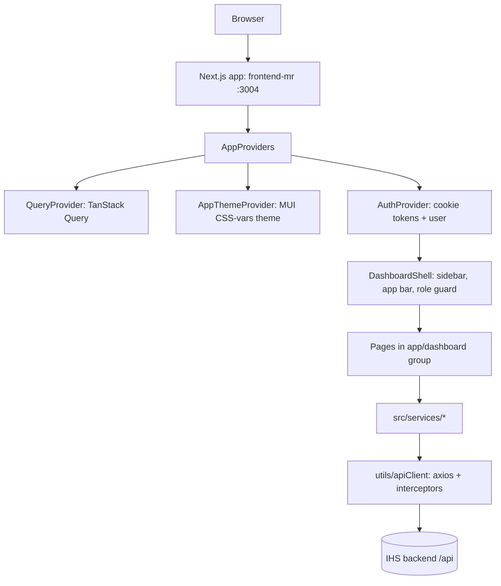
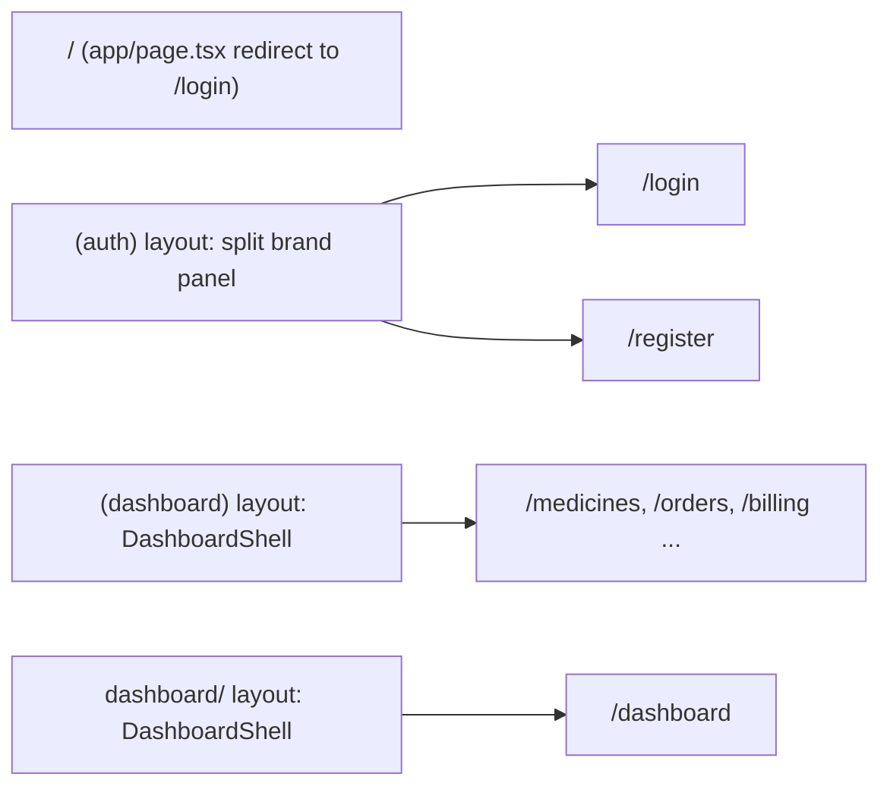
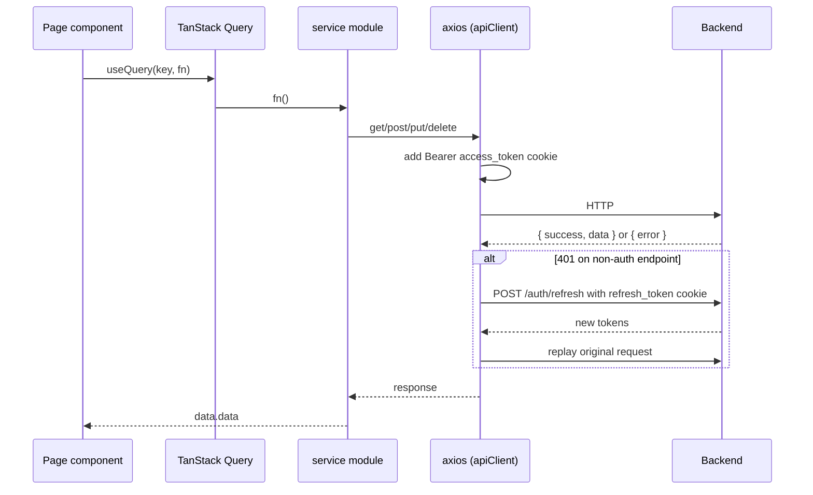

# Architecture

## Overview

A client-rendered Next.js 16 App Router application. All pages under `src/app/(dashboard)` and `src/app/(auth)` are Client Components (`"use client"`); there are no Next.js route handlers, no server actions and no server-side data fetching. The server only serves the shell. All data comes from the IHS backend over HTTP from the browser.

## Layers

| Layer | Location | Responsibility |
|---|---|---|
| Routes / pages | `src/app/` | Route groups `(auth)` and `(dashboard)`, page components, loading/error/not-found |
| Feature modules | `src/features/` | Role-aware nav, pharmacy widgets, diagnostics widgets, medicine media widgets, status label maps |
| Shared UI | `src/components/` | Cards, forms (RHF), dialogs, feedback states, typography, pagination, Google Maps autocomplete |
| Services | `src/services/` | One module per backend area; return unwrapped `data.data` |
| HTTP | `src/utils/apiClient.ts`, `src/utils/apiError.ts` | axios instance, token injection, 401 refresh, error-message extraction |
| Config | `src/config/` | `env.ts` (zod-validated env), `api.ts` (endpoint registry), `site.ts` |
| State | `src/providers/` | Query client, theme, auth context |
| Theme | `src/theme/` | Palette, typography, shape, shadows, component overrides, tokens |
| Types | `src/types/` | Domain interfaces (`index.ts` is ~760+ lines), MUI theme augmentation |

## Root layout and providers

`src/app/layout.tsx` loads the Plus Jakarta Sans font (`next/font/google`), sets metadata (`robots: { index: false, follow: false }` because this is a signed-in console), renders `InitColorSchemeScript attribute="class" defaultMode="light"`, and wraps children in `AppProviders`.

Provider order (`src/providers/AppProviders.tsx`): `QueryProvider` > `AppThemeProvider` > `AuthProvider` > children + sonner `<Toaster richColors closeButton position="top-right" theme="system" />`.

## Route groups

* `(auth)/layout.tsx`: left brand panel (hidden below `md`) with three highlight bullets, right form area.
* `(dashboard)/layout.tsx`: wraps children in `DashboardShell`.
* `src/app/dashboard/layout.tsx` and `page.tsx`: a second route at the literal path `/dashboard` that also uses `DashboardShell` and renders `LabOverview` or `PharmacyOverview`. This is the target of `ROUTES.DASHBOARD`.
* `src/app/(dashboard)/page.tsx`: an older stats page (4 `StatisticCard` tiles using direct `apiClient` calls) that resolves to path `/` and therefore collides with `src/app/page.tsx`. See `KNOWN-LIMITATIONS-AND-DISCREPANCIES.md`.

## Request flow

## Key design choices (verified in code)

* **Env inlining**: `src/config/env.ts` references each `process.env.NEXT_PUBLIC_*` literally because Next only inlines literal expressions; a comment records that parsing the whole `process.env` left the Maps key and API URL at defaults in the built client.
* **React Compiler** is enabled (`reactCompiler: true` in `next.config.ts`, `babel-plugin-react-compiler` 1.0.0).
* **UX-only role guard** in `DashboardShell`/`nav.ts`; real authorisation is the backend's (403).
* **Money and dates**: formatting helpers in `src/utils/format.ts` (`formatCurrency`, `formatDateTime`, `formatNumber`, `formatDay`, `todayDay`, `getInitials`); report ranges are `YYYY-MM-DD` day strings (IST per the service comment).
* **Files**: prescriptions, diagnostic files and reports are fetched with `responseType: "blob"` through authenticated endpoints and shown via object URLs; there are no public file links.
* **Printing**: invoices, credit notes and purchase pages use `window.print()`; there is no PDF library in the app.
