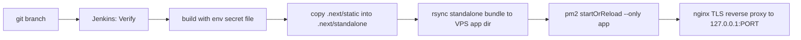

# Deployment Guide

## What is defined for this app

| Item | Status |
|---|---|
| `next.config.ts` `output: "standalone"` | Present (self-contained server bundle) |
| `npm run build` / `npm start` (port 3004) | Present |
| Dockerfile | Not found in this folder |
| Entry in root `Jenkinsfile` app registry (`APPS`) | **Not present** (registry lists backend, patient, doctor, admin, clinic) |
| Entry in root `ecosystem.config.js` (pm2) | **Not present** (prod ports 3000-3003 and dev 3010-3013) |
| `.github/workflows/deploy.yml` frontend steps | None matching this app were found |
| Production env file | Not defined (no Jenkins credential id such as `ihs-env-mr`) |

Conclusion: nothing in the repository, as read on 2026-11-16, deploys `frontend-mr` automatically. The sections below describe the manual build, and how the other Next portals are deployed so this one can be added the same way. Adding it to Jenkins/pm2 would modify files outside this folder and is out of scope for this document.

## Build

```bash
cd frontend-mr
# create the production env file with the real NEXT_PUBLIC_* values FIRST
npm ci            # or npm install
npm run build     # next build -> .next/ (standalone bundle in .next/standalone)
```

`NEXT_PUBLIC_*` values are baked in at build time (see `ENVIRONMENT-CONFIGURATION.md`): build once per environment, with that environment's API URL and Maps key.

Because `.env.production` and `.env.development` are git-ignored, supply the env file out of band (the platform's convention for other portals is a Jenkins secret-file credential that holds the build-time `.env`).

## Run

Option A - Next server: `npm start` (serves on 3004).

Option B - standalone bundle (matches how the other portals run under pm2 per `ecosystem.config.js` comments): `output: "standalone"` emits `.next/standalone/server.js`. It does not include static assets by default, so copy `.next/static` into `.next/standalone/.next/static` and `public/` (if any; this app has no `public/`) into `.next/standalone/public`. The standalone server reads `PORT` and `HOSTNAME` from the environment (it ignores `-p`), e.g.:

```bash
PORT=3004 HOSTNAME=127.0.0.1 node .next/standalone/server.js
```

(In a monorepo with a lockfile at the repo root Next may nest the bundle under a subfolder; check the actual `.next/standalone` layout after building. Not verified here.)

## Reference: how the other portals are deployed (from the root `Jenkinsfile` and `ecosystem.config.js`)



* pm2 apps run `server.js` with `PORT`, `HOSTNAME=127.0.0.1`, `max_memory_restart: "512M"`, one instance, logs under the deploy root.
* TLS is terminated by nginx in front of the loopback process.
* Details: `docs-shared/ci` (Jenkins setup) - referenced by name only.

To onboard this app the same way someone would need: an `APPS` entry (`key`, `dir: 'frontend-mr'`, `type: 'next'`, credential ids), a pm2 entry with a free port (3004 matches local), and an nginx server block. None of these exist today.

## Pre-deploy checklist

1. `NEXT_PUBLIC_API_URL` points to the production API (HTTPS).
2. `NEXT_PUBLIC_GOOGLE_MAPS_API_KEY` is a referrer-restricted key for the production domain (or blank).
3. Backend CORS allows the portal origin; cookies use `secure` automatically on HTTPS.
4. `npm run lint` passes or known issues are accepted (see `KNOWN-LIMITATIONS-AND-DISCREPANCIES.md`).
5. The duplicate `/` page issue is resolved or confirmed harmless by a successful `npm run build`.
6. The tracked `.env` does not contain a real key (audit item).
7. `/og.png` referenced by `siteConfig.ogImage` does not exist in the tree (no `public/`), so social previews would 404.

## Rollback

No release mechanism is defined here. With pm2 deployments, roll back by re-deploying the previous build artifact and reloading the process. Nothing in this repo automates it for this app.
