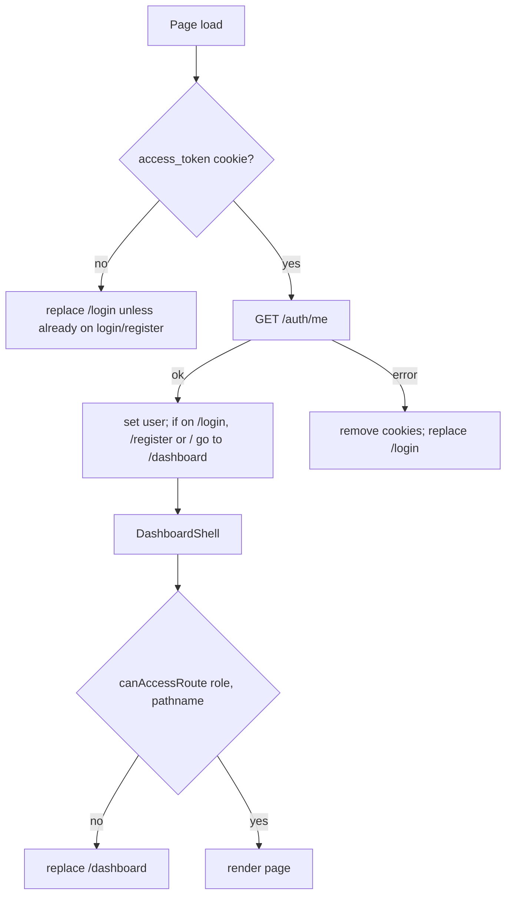

# Routing and Navigation

Next.js App Router, file-based. The route table is mirrored in `src/constants/routes.ts` (`ROUTES`). There is no `middleware`/`proxy` file: all protection is client-side.

## Route table

| Path | File | Access | Notes |
|---|---|---|---|
| `/` | `app/page.tsx` | public | `redirect("/login")`. See collision note below |
| `/login` | `app/(auth)/login/page.tsx` | public | redirected to `/dashboard` when a valid session exists |
| `/register` | `app/(auth)/register/page.tsx` | public | same redirect |
| `/dashboard` | `app/dashboard/page.tsx` | any signed-in provider | `LabOverview` for `diagnostic_lab`, else `PharmacyOverview` |
| `/medicines` | `(dashboard)/medicines/page.tsx` | pharmacy | list |
| `/medicines/new` | `.../new/page.tsx` | pharmacy | add |
| `/medicines/import` | `.../import/page.tsx` | pharmacy | bulk import |
| `/medicines/[id]/edit` | `.../[id]/edit/page.tsx` | pharmacy | edit, batches, ledger, media |
| `/categories` | `.../categories/page.tsx` | pharmacy | not in sidebar |
| `/categories/new` | `.../categories/new/page.tsx` | pharmacy | not in sidebar |
| `/inventory` | `.../inventory/page.tsx` | pharmacy | `?tab=` expiring, expired, batches, low, out |
| `/purchases` | `.../purchases/page.tsx` | pharmacy | `?supplierId=` filter used by Suppliers |
| `/purchases/new` | `.../purchases/new/page.tsx` | pharmacy | record purchase |
| `/purchases/[id]` | `.../purchases/[id]/page.tsx` | pharmacy | detail, print, cancel |
| `/suppliers` | `.../suppliers/page.tsx` | pharmacy | |
| `/orders` | `.../orders/page.tsx` | pharmacy | order groups |
| `/orders/[id]` | `.../orders/[id]/page.tsx` | pharmacy | detail, invoice, returns |
| `/prescriptions` | `.../prescriptions/page.tsx` | pharmacy | requests |
| `/prescriptions/[id]` | `.../prescriptions/[id]/page.tsx` | pharmacy | availability editor |
| `/billing` | `.../billing/page.tsx` | pharmacy | tabs invoices/payments/returns |
| `/billing/returns/[id]` | `.../billing/returns/[id]/page.tsx` | pharmacy | credit note |
| `/reports` | `.../reports/page.tsx` | pharmacy | |
| `/settings` | `.../settings/page.tsx` | pharmacy | |
| `/diagnostics` | `.../diagnostics/page.tsx` | lab | request list |
| `/diagnostics/[id]` | `.../diagnostics/[id]/page.tsx` | lab | |
| `/diagnostics/tests` | `.../diagnostics/tests/page.tsx` | lab | catalogue |
| `/notifications` | `.../notifications/page.tsx` | both | |
| `/profile` | none | - | constant defined, no page |

Special files: `app/loading.tsx`, `app/error.tsx`, `app/not-found.tsx`.

## Sidebar (from `src/features/dashboard/nav.ts`)

Pharmacy roles:

| Section | Items (route) |
|---|---|
| (none) | Dashboard (`/dashboard`) |
| Medicines | All Medicines (`/medicines`), Add Medicine (`/medicines/new`), Bulk Import (`/medicines/import`) |
| Inventory | Stock & Expiry (`/inventory`) |
| Purchases | Purchases (`/purchases`), Suppliers (`/suppliers`) |
| Orders | Patient Orders (`/orders`), Prescription Orders (`/prescriptions`) |
| Billing | Invoices & Payments (`/billing`) |
| Insights | Reports (`/reports`) |
| Account | Notifications (`/notifications`), Settings (`/settings`) |

`Categories` is commented out of this list in source.

Diagnostic lab role: Overview (`/dashboard`), Diagnostic Requests (`/diagnostics`), Tests (`/diagnostics/tests`), Notifications (`/notifications`).

Active item: the longest matching `href` wins (so `/diagnostics/tests` does not also highlight `/diagnostics`); `/dashboard` only matches exactly. Page title in the app bar is the active item's label (default "Dashboard"). The sidebar is permanent at `md` and up (264 px, `DRAWER_WIDTH`) and a temporary drawer below it; the app bar shows a role chip (hidden on `xs`) and an avatar menu with the user's name, email and "Sign out". Section headings are rendered once per run of items with the same `section`.

## Guards

* `AuthProvider` runs its bootstrap effect on every `pathname` change (it re-calls `GET /auth/me` on each navigation; see `STATE-AND-DATA-FETCHING.md`).
* `DashboardShell` shows a full-screen loader while `loading`, when there is no user, or when the route is forbidden for the role; it redirects to `/login` when unauthenticated.
* `canAccessRoute(role, pathname)`: a `diagnostic_lab` is blocked from `PHARMACY_ONLY_ROUTES` (medicines, categories, inventory, purchases, suppliers, orders, prescriptions, billing, reports, settings); every other role is blocked from `LAB_ONLY_ROUTES` (`/diagnostics`). Documented in code as "UX-only ... the backend enforces access with 403s".

## Redirect behaviour on logout

`logout()` calls `POST /auth/logout` (errors ignored), removes both cookies, clears the user and navigates to `/login`.

## Known route issues

* `src/app/page.tsx` (redirect) and `src/app/(dashboard)/page.tsx` (legacy stats page) both resolve to `/`. The `.next/app-path-routes-manifest.json` snapshot present locally lists both for `/`. Next normally rejects two pages for the same path at build time; whether the committed build passes with this layout could not be verified (the old docs record green builds before the second page changed). Treat the effective behaviour of `/` as **Unclear**; `/dashboard` is the supported entry point.
* `/profile` has no page.
